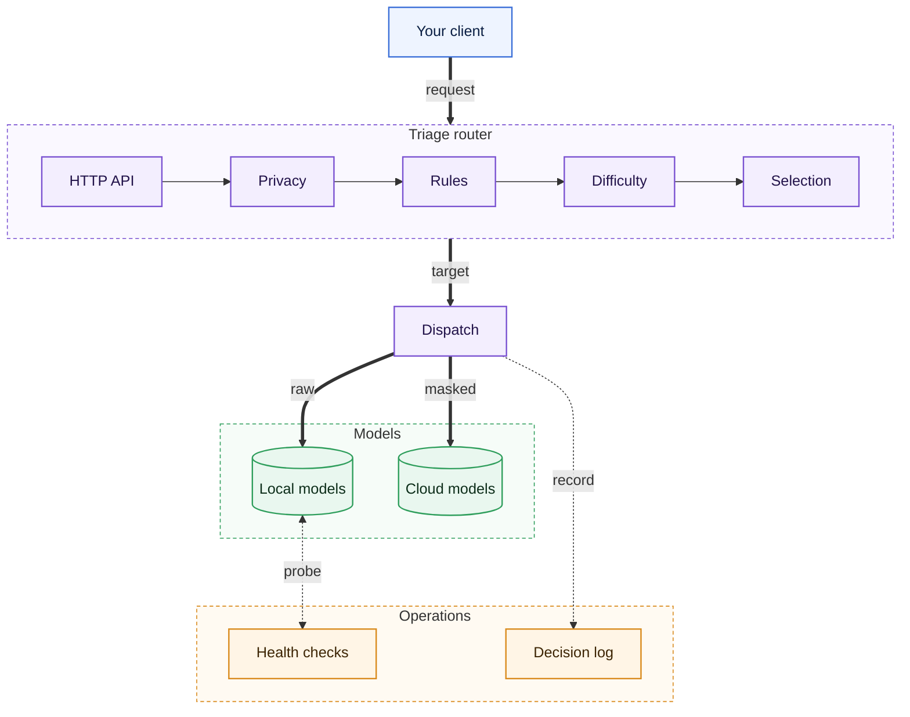

# Triage

An OpenAI-compatible proxy that routes each LLM request to a local or cloud model by difficulty and privacy.

[](https://github.com/thnhdatle/triage/actions/workflows/ci.yml)
[](https://github.com/thnhdatle/triage/releases)
[](LICENSE)

## Architecture



Each request passes a fixed pipeline: privacy detection, rules, difficulty scoring and target
selection, which skips models that fail health checks. Dispatch masks detected PII for cloud
targets, falls back on failure and records an explanation for every decision.

## Why

Teams that run local models and also pay for cloud models usually send everything to one place.
That means paying cloud prices for easy prompts, or accepting lower quality on hard ones, and
sensitive prompts reach cloud providers because nothing checks them. Triage scores each request,
checks it for detectable PII, and picks a local or cloud model accordingly. Every decision is
recorded with its reason, so you can see why a request went where it did.

## Install

```sh
docker run --rm ghcr.io/thnhdatle/triage:v0.1.1 version      # router in Docker, ONNX Runtime included
go install github.com/thnhdatle/triage/cmd/triage@v0.1.1      # from source, needs cgo
```

Prebuilt binaries for Linux (amd64, arm64) are on the [releases page](https://github.com/thnhdatle/triage/releases).
Outside the image, the `bert` strategy and NER need ONNX Runtime 1.29 or newer, see
[operations](docs/guides/operations.md#onnx-runtime-library).

## Quickstart

Needs Git and Docker. It runs against a fake provider, with no model downloads:

<!-- quickstart:start -->
```bash
git clone https://github.com/thnhdatle/triage.git && cd triage
docker compose -f deploy/docker-compose.yml up -d --wait
curl -si localhost:8080/v1/chat/completions -H 'Content-Type: application/json' -d '{"model":"triage-auto","messages":[{"role":"user","content":"Hello"}]}'
docker compose -f deploy/docker-compose.yml down -v
```
<!-- quickstart:end -->

The response carries `X-Triage-Route` and `X-Triage-Target` headers that show where it went.

## Usage

```yaml
auth:
  keys_env: TRIAGE_API_KEYS
providers:
  lmstudio: { type: openaicompat, base_url: "http://localhost:1234/v1" }
  openai: { type: openaicompat, base_url: "https://api.openai.com/v1", api_key_env: OPENAI_API_KEY }
targets:
  - { name: local-small, provider: lmstudio, model: qwen/qwen3-vl-4b, locality: local, tier: weak, context_window: 32768 }
  - { name: cloud-strong, provider: openai, model: gpt-5, locality: cloud, tier: strong, context_window: 200000 }
routes:
  - name: triage-auto
    privacy: { mode: mask }
    strategy: length
    threshold: 0.5
```

```sh
TRIAGE_API_KEYS=my-key OPENAI_API_KEY=sk-... triage serve --config config.yaml
```

Short prompts go to the local model. Long prompts go to the cloud model, with detected PII
replaced by placeholders. Point any OpenAI client at `http://127.0.0.1:8080/v1` with the model `triage-auto`. Strategies,
privacy modes, fallback and evaluation are covered in the [guides](docs/guides).

## Performance

MacBook Pro M3 Pro 36 GB, Triage v0.1.0, zero-latency fake upstream, `length` strategy with `mask`,
medians of 3 runs. Overhead is paired: each request goes at the same instant directly to the fake
upstream and through Triage.

| Scenario | Result |
|---|---|
| Router overhead p99 at 500 RPS | 1.731 ms |
| Highest sustained throughput, p99 at that step | 7,999 RPS, 6.153 ms |
| Learned scoring p99 at 5 RPS | 164 ms |

## Documentation

- [Guides](docs/guides)
- [Roadmap](ROADMAP.md)
- [Changelog](CHANGELOG.md)
- [Contributing](CONTRIBUTING.md)
- [Security](SECURITY.md)
- [License: Apache-2.0](LICENSE)
